# Project Plan: Website Portfolio

## Metadata
| Key | Value |
| --- | --- |
| ID | PP-001 |
| CrossReference | [BC-001], [SA-001], [MIL-001], [MIL-002], [MIL-003], [MIL-004] |
| Language | en |
| Domain | it |

## Version History
| Date | Status | Author | Reviewer | Change | Commit |
| --- | --- | --- | --- | --- | --- |
| 2026-11-19 | Accepted | Jens Tirsvad Nielsen | Stand-in for S01 | Initial version | [8163226] |

---

## Purpose

This plan schedules the four gateways that deliver the Day 83 portfolio website: project setup, core domain and use cases, site generation and preview, and documentation. It fits the Business Case constraint that the assignment is sized at about 60 minutes in the course and is kept small, so the whole project is planned as one short working window with one pull request per gateway.

## Planning Assumptions

| # | Assumption | Source |
| --- | --- | --- |
| A1 | The plan starts on 2026-11-19, the day the request was given, and ends on 2026-11-23. S01 named no deadline; the end date is a planning assumption, not a commitment. | [BC-001] Constraints |
| A2 | Each gateway lasts one day or less and is delivered as one branch and one pull request that closes the issues of its tasks. | [BC-001] Constraints |
| A3 | The baseline documents (Business Case, Stakeholder Analysis, Project Plan, the four milestones, the decision record, governance and traceability matrix) are reviewed and accepted before gateway MIL-001 starts. They are delivered in a baseline pull request that closes no issue, because it has none. | [BC-001] Methodological and Standards Foundation |
| A4 | S01 is the owner and the approving reviewer of every gateway. In autonomous mode the reviewer role is exercised as a stand-in and each review record says `Mode: autonomous, not independent`. | [SA-001] Conflicting Interests |
| A5 | The wiki is published by the organisation's publishing workflow after the merge of MIL-004; the wiki must be enabled in the repository settings. | [BC-001] Assumptions |
| A6 | Screenshots are taken in a Docker container with a headless browser, never on the host desktop. | [BC-001] Risks |

## Gateway Schedule

| Gateway | Document | Window | Decision date | Owner | Stories | Main deliverable | Milestone |
| --- | --- | --- | --- | --- | --- | --- | --- |
| MIL-001 Project setup | [MIL-001] | 2026-11-19 to 2026-11-20 | 2026-11-20 | S01 | none (technical tasks) | An installable Python project skeleton with tooling files, a passing smoke test, a Doxyfile and a described, tagged repository | not yet synced |
| MIL-002 Core domain and use cases | [MIL-002] | 2026-11-21 | 2026-11-21 | S01 | none (technical tasks) | Domain entities and the `home` and `about` use cases with ports, unit-tested with fakes and checked by a layer contract | not yet synced |
| MIL-003 Site generation and preview | [MIL-003] | 2026-11-22 | 2026-11-22 | S01 | none (technical tasks) | `python -m portfolio build` and `python -m portfolio serve` working end to end on sample data, with `load_from_json`, a stylesheet and integration and end-to-end tests | not yet synced |
| MIL-004 Documentation and wrap-up | [MIL-004] | 2026-11-23 | 2026-11-23 | S01 | none (documentation tasks) | README, Doxygen reference and a wiki in English, Danish and Bahasa Malaysia with one screenshot per step | not yet synced |

## Timeline diagram

```plantuml
@startgantt
Project starts 2026-11-19
[MIL-001 Project setup] starts 2026-11-19 and ends 2026-11-20
[MIL-002 Core domain and use cases] starts 2026-11-21 and ends 2026-11-21
[MIL-003 Site generation and preview] starts 2026-11-22 and ends 2026-11-22
[MIL-004 Documentation and wrap-up] starts 2026-11-23 and ends 2026-11-23
[Go MIL-001] happens 2026-11-20
[Go MIL-002] happens 2026-11-21
[Go MIL-003] happens 2026-11-22
[Go MIL-004] happens 2026-11-23
[MIL-001 Project setup] -> [MIL-002 Core domain and use cases]
[MIL-002 Core domain and use cases] -> [MIL-003 Site generation and preview]
[MIL-003 Site generation and preview] -> [MIL-004 Documentation and wrap-up]
@endgantt
```

## Scope Coverage

| Business Case in-scope item | Gateway |
| --- | --- |
| Python package with the four layers and `constants.py` | MIL-001 (package and constants), MIL-002 (domain, application), MIL-003 (infrastructure, presentation) |
| Sample `projects.json`, home page, about page, stylesheet and local preview server | MIL-003 |
| Tests under `tests/` run with pytest | MIL-001 (smoke test), MIL-002 (unit), MIL-003 (integration, end to end) |
| `pyproject.toml`, Python `.gitignore`, `.editorconfig`, Doxygen configuration and Doxygen comments | MIL-001 (files), MIL-002 and MIL-003 (comments in the source), MIL-004 (Doxygen run) |
| README from the framework template and the three-language wiki with Getting Started | MIL-004 |
| Screenshots of this project's own output for every step | MIL-004 |
| Repository description and topics | MIL-001 |

## Dependencies

The gateways form a chain: MIL-001 precedes MIL-002, which precedes MIL-003, which precedes MIL-004. MIL-004 needs the working site of MIL-003 for its screenshots. A No-Go on a gateway stops the later gateways until its findings are fixed and it is reviewed again; the dates of the later gateways and the end date then move by the same number of days. S01 decides the move of the end date and records it in a new Version History row of this plan.

## Plan Risks

| Risk | Impact | Mitigation | Business Case risk |
| --- | --- | --- | --- |
| The Docker image for headless screenshots cannot be pulled or run | Medium: MIL-004 screenshots are blocked | Check the Docker engine at the start of MIL-003; if it fails, stop and report instead of using the host desktop | Screenshots taken on the host desktop |
| The git host tokens lack a scope for issues, wiki or repository settings | Medium: sync, topics or wiki publishing fail | Check each endpoint when first needed; stop and report instead of working around it | Gitea tokens lack a scope |
| The opengrep scan reports findings that block a push | Medium: a milestone slips | Fix the finding or record why it is a false positive in the review record; never push past an open High finding | Local opengrep binary is missing or outdated |
| Danish and Bahasa Malaysia pages contain wording errors | Medium: weaker documentation | Short sentences, commands and code in English; the language check stays Pending until a person who reads the language has checked it | Texts without a native reviewer |
| A review ends `Go-with-conditions` because a criterion only a person can confirm stays Pending | High: the gate blocks the next gateway | Ask S01 at plan acceptance to confirm the language criteria of the English artifacts; stop and report if the gate still blocks | Reviewer is also the author |

## Open Issues

| # | Issue | Owner |
| --- | --- | --- |
| OI-001 | The end date 2026-11-23 is an assumption; S01 may set another date at plan acceptance. | S01 |
| OI-002 | The Timeline diagram has not been rendered because no PlantUML server is set in the registry; the text is checked by reading. | S01 |

---

[BC-001]: ./business-case.md
[SA-001]: ./stakeholder-analysis.md
[MIL-001]: ./milestones/mil-001-project-setup.md
[MIL-002]: ./milestones/mil-002-core-domain-and-use-cases.md
[MIL-003]: ./milestones/mil-003-site-generation-and-preview.md
[MIL-004]: ./milestones/mil-004-documentation-and-wrap-up.md
[8163226]: https://git.tirsystem.com/Tirsvad-Udemy-100-days-of-code/083-assignment-website-portfolio/commit/816322642c270c0dc5fa0f722c0b3e3f41de5187
